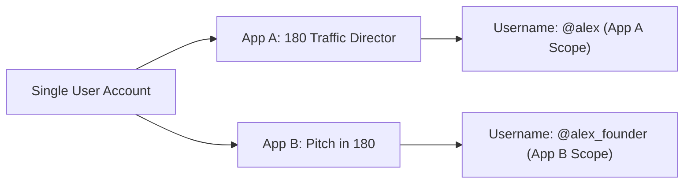

# Universal Login Flow & Adaptive Sheet Architecture

180 Identity uses an adaptive in-DOM presentation model that is fully responsive across mobile and desktop devices with zero developer configuration:

| Viewport / Device | Presentation | Behavior |
| :--- | :--- | :--- |
| **Mobile (< 768px)** | **Touch-Friendly Bottom Sheet** | Slides up smoothly from the bottom with WhatsApp 1-tap OTP and credential login. Zero popup blocker failure on Safari iOS, Chrome Android, and privacy-shielded browsers. |
| **Desktop (≥ 768px)** | **Centered Glass Modal Card** | Centers a focused `480px` modal dialog with backdrop blur directly within the app DOM. Communicates securely via `postMessage` and resolves the authentication token directly into your Promise. |

:::tip Zero Popup Blockers & Reliable Payment Gateway Return
Because the sheet renders directly inside the application DOM via an isolated iframe overlay rather than a detached browser window (`window.open`), it is completely immune to mobile browser popup blockers and avoids severed `window.opener` references when completing third-party payment gateways like PhonePe or UPI.
:::

---

## 1. Zero-Config UX Architecture

Developers never need to configure or toggle complex display modes or handle device-specific popup branches. The SDK automatically detects the viewport and manages the presentation:

- **Mobile Viewports**: Auto-docks as a bottom sheet with touch gestures.
- **Desktop Viewports**: Auto-centers as a modal card with smooth backdrop animations.
- **Single-Line Trigger**: `OneEighty.auth.signIn({ clientId: '...' })` or `OneEightyIdentity.openBottomSheet({ clientId: '...' })`.
- **Legacy Aliases**: Calls to `openPopup()` or `openLoginPopup()` are preserved for backward compatibility and seamlessly route to the adaptive in-DOM sheet.

---

## 2. Using PKCE (Proof Key for Code Exchange)

For Single Page Applications (SPAs) or mobile apps that cannot securely store a `CLIENT_SECRET`, 180 Identity supports **RFC 7636 PKCE** using `S256` code challenges.

### Generating Code Verifier and Challenge:
```ts
function generateCodeVerifier(): string {
  const array = new Uint8Array(32);
  crypto.getRandomValues(array);
  return Array.from(array, dec => dec.toString(16).padStart(2, '0')).join('');
}

async function generateCodeChallenge(verifier: string): Promise<string> {
  const encoder = new TextEncoder();
  const data = encoder.encode(verifier);
  const digest = await crypto.subtle.digest('SHA-256', data);
  return btoa(String.fromCharCode(...new Uint8Array(digest)))
    .replace(/\+/g, '-')
    .replace(/\//g, '_')
    .replace(/=+$/, '');
}
```

### Passing PKCE to Authorization URL:
```text
https://profile.180core.cloud/auth/login?
  client_id=180_client_...&
  redirect_uri=https://yourapp.com/callback&
  response_type=code&
  scope=openid identity:read&
  code_challenge=E9Melhoa2OwvFrEMTJguCHaoeK1t8URWbuGJSstw-cM&
  code_challenge_method=S256&
  state=secure_random_state_string&
  ux_mode=bottom_sheet
```

---

## 3. Per-App Username Isolation

Unlike legacy identity providers where usernames are global across the whole internet, 180 Identity enforces **cryptographic per-app isolation**:



When querying `GET /api/oauth/userinfo`, the returned `username` field is guaranteed to be unique and scoped specifically to your application. A user choosing `@satoshi` in App A does not prevent another user from claiming `@satoshi` in App B.
