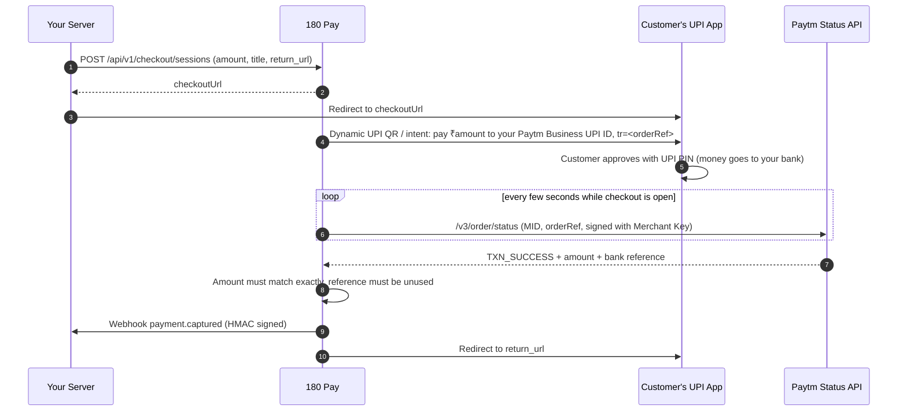

# Direct UPI & Paytm for Business Auto-Verification

Direct UPI lets customers pay **straight into your own bank account** using any UPI app (PhonePe, Google Pay, Paytm, BHIM, bank apps). 180 Pay never holds the money and charges **0% on Direct UPI payments**.

The only hard part of direct UPI is knowing *that* a customer paid. 180 Pay solves this two ways:

| | **Paytm for Business** (recommended) | **Any other UPI ID** |
| :--- | :--- | :--- |
| What you connect | Paytm Business UPI ID + Production **MID** + **Merchant Key** | Any UPI ID (personal or business) |
| How payments are confirmed | 180 Pay asks Paytm's official Transaction Status API every few seconds | You forward bank credit alerts (email / SMS / notification) to your Bank Listener webhook |
| Typical confirmation time | ~2–5 seconds, fully automatic | Seconds after your bank sends the alert |
| Setup effort | 2 minutes | Needs an email or notification forwarder |

:::caution Personal UPI accounts
Most banks' terms do not allow personal savings accounts to collect business payments, and accounts receiving high volumes of business payments may be frozen. For business use, connect a merchant account such as Paytm for Business.
:::

---

## 1. How it works



Every checkout gets its own order reference, so each payment is matched to exactly one order. A payment is captured only when **Paytm itself** reports `TXN_SUCCESS` for that reference **with the exact amount**. A UTR typed in by the customer is never accepted on its own for Paytm-connected apps.

---

## 2. Connect Paytm for Business

### What you need from Paytm

1. **Production MID** and **Merchant Key** (16 characters)
   Paytm for Business dashboard or app → **Developer Settings → API Keys** → Production. You may need to complete KYC and activate online payments before Production keys appear.
2. **Your Paytm Business UPI ID**
   Scan your Paytm Business QR with a plain QR reader (not a UPI app). It shows `upi://pay?pa=XXXX@paytm&...`. The value after `pa=` is your UPI ID.

### Configure 180 Pay

1. Open the [180 Developer Console](https://developer.180core.cloud) → your app → **Pay → Gateways**.
2. Turn on **Rail 1: Direct Native UPI**.
3. Enter your **Paytm Business UPI ID** as the *Receiving UPI ID* and a *Display Business / Store Name*.
4. Turn on **Paytm for Business auto-verification** and enter your **Production MID** and **Merchant Key**.
5. Click **Test connection**. You should see *"Paytm for Business credentials verified"*.
6. Click **Save Settings**.

Your Merchant Key is encrypted at rest and is only ever used server-side to sign status requests.

| Test connection result | Meaning | Fix |
| :--- | :--- | :--- |
| Verified | MID and key accepted by Paytm | Done |
| Rejected `330` | Checksum mismatch | Wrong Merchant Key, or a Staging key was used |
| Rejected `335` | Invalid MID | Copy the Production MID again |
| Could not confirm right now | Paytm did not answer clearly | Retry in a minute |

:::note One custom gateway per app
Paytm for Business auto-verification and a custom Razorpay/Stripe BYOG account cannot be active on the same app. 180 Managed Processing (cards, netbanking) can still run alongside Paytm.
:::

---

## 3. Create a checkout

Create checkout sessions **from your server**, exactly as for any other 180 Pay checkout ([full reference](./02-checkout-integration.md)):

```bash
curl -X POST https://api.180core.cloud/api/v1/checkout/sessions \
  -H "Authorization: Bearer $ONE_EIGHTY_CLIENT_SECRET" \
  -H "Content-Type: application/json" \
  -d '{
    "client_id": "180_client_...",
    "amount": 199,
    "currency": "INR",
    "title": "Order #1042",
    "order_id": "ord_1042",
    "return_url": "https://myshop.com/thanks?order=ord_1042",
    "metadata": { "orderId": "ord_1042" }
  }'
```

Redirect the customer to the returned `checkoutUrl`. What the customer sees:

- **Desktop:** a dynamic UPI QR with the exact amount. They scan it inside PhonePe, Google Pay, Paytm or BHIM.
- **Mobile:** *Open Installed UPI Apps* launches their UPI app with the amount pre-filled. *Copy UPI ID* and *Save QR* are offered as fallbacks.
- The page confirms on its own and redirects to your `return_url`. Nobody types a UTR.

Minimum amount is ₹1. Amounts in other currencies are converted to INR for UPI.

---

## 4. Fulfil the order (server-side only)

:::danger Never fulfil on the redirect alone
Customers can open your `return_url` without paying. Unlock goods only after one of the server-side checks below.
:::

### Option A: Webhook (recommended)

180 Pay sends `payment.captured` (and its alias `payment.succeeded`) to your webhook endpoint, signed exactly as described in [Webhooks & HMAC Verification](./07-webhook-integration.md):

```json
{
  "event": "payment.captured",
  "data": {
    "sessionId": "sess_...",
    "transactionId": "pay_upi_633212345678_1764331234567",
    "amount": 199,
    "currency": "INR",
    "title": "Order #1042",
    "gateway": "DIRECT_UPI",
    "utr": "633212345678",
    "payeeVpa": "paytmqr...@paytm",
    "verificationType": "PAYTM_BUSINESS_STATUS_API",
    "isProvisional": false,
    "status": "CAPTURED",
    "timestamp": "2026-11-28T14:20:31.000Z"
  }
}
```

- `utr` is the bank reference (RRN) from Paytm. If Paytm returns none, it is `PTM_<paytm txn id>`.
- `verificationType` is `PAYTM_BUSINESS_STATUS_API` for Paytm-confirmed payments and `NPCI_BANK_UTR` for bank-alert confirmations.
- Deduplicate on `sessionId`: webhooks can be delivered more than once.

### Option B: Poll the status endpoint

```http
GET https://api.180core.cloud/api/v1/checkout/sessions/{sessionId}/status
```

```json
{ "success": true, "status": "CAPTURED", "isPaid": true, "transactionId": "pay_upi_...", "returnUrl": "https://myshop.com/thanks" }
```

Calling this endpoint also triggers a fresh Paytm check, so it is safe to poll every 2–3 seconds.

---

## 5. Edge cases handled for you

| Situation | What 180 Pay does |
| :--- | :--- |
| Customer pays the wrong amount | Not captured. Refund the customer from your Paytm dashboard. |
| Customer pays after the checkout window expired | Captured anyway, because the money already reached you. |
| Payment fails (wrong PIN, bank down) | Order stays pending. A retry gets a fresh order reference. |
| Same bank reference submitted for two orders | Second one is rejected. |
| Paytm API temporarily down | Order stays pending and is confirmed on the next successful check. The background reconciler re-checks recent pending orders. |
| Customer closes the tab after paying | Background reconciliation still captures it and sends your webhook. |

---

## 6. Using a non-Paytm UPI ID (Bank Listener)

If you connect any other UPI ID, payments confirm when your bank's credit alert reaches 180 Pay:

1. In **Pay → Gateways**, copy the **Bank Listener Webhook URL** and the **`x-180-bank-secret`** value.
2. Forward bank credit alerts to that URL with the secret header, using an email forwarder (Gmail/Outlook rules) or an Android notification forwarder (MacroDroid/Tasker).
3. 180 Pay reads the amount and 12-digit UTR from the alert, matches it to the open checkout, and captures it.

```bash
curl -X POST https://api.180core.cloud/api/v1/checkout/upi-bank-webhook \
  -H "x-180-bank-secret: $BANK_LISTENER_SECRET" \
  -H "Content-Type: application/json" \
  -d '{ "appId": "180_client_...", "rawText": "Rs.199.00 credited to a/c XX1234 by UPI Ref 633212345678 ..." }'
```

---

## 7. FAQ

**Does 180 Pay take a cut of Direct UPI payments?**
No. Money moves from the customer's bank straight to yours.

**Can I use a personal Paytm account?**
No. Auto-verification needs a Paytm for **Business** account, because only merchant accounts have a MID and status API. Personal UPI IDs can use the Bank Listener method.

**Refunds?**
Direct UPI money never passes through 180 Pay, so refunds are issued from your Paytm for Business dashboard or banking app.

**Is my Merchant Key safe?**
It is encrypted at rest (AES-256-GCM), never sent to browsers, and only used to sign Paytm status requests.
